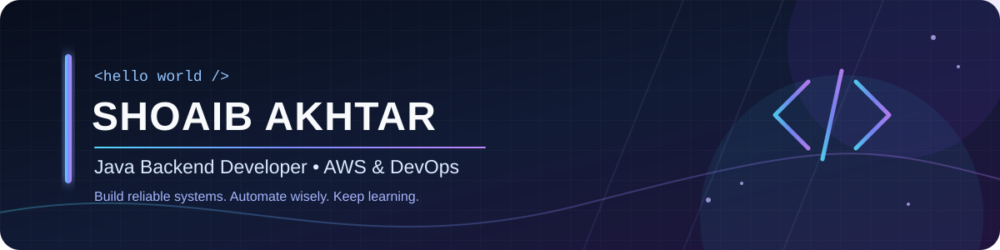

  

  

    <b>Final-year B.Tech IT @ MSIT Delhi</b> 
    I build backend applications, explore cloud-native technologies, and solve practical engineering problems.
  

  
  
  

    
  
  

---

## 🟩 Contribution Activity

  <picture>
    <source media="(prefers-color-scheme: dark)" srcset="https://raw.githubusercontent.com/shoaib6875/shoaib6875/output/github-contribution-grid-snake-dark.svg" />
    <source media="(prefers-color-scheme: light)" srcset="https://raw.githubusercontent.com/shoaib6875/shoaib6875/output/github-contribution-grid-snake.svg" />
    
  </picture>

## 🚀 Featured Projects

<table>
  <tr>
    <td width="50%" valign="top">
      <h3>🔄 RenewIQ</h3>
      
<b>Intelligent Subscription &amp; Billing Platform</b>

      
A SaaS-style app for managing customers, plans, subscriptions, renewals, and billing workflows.

      
<code>Java</code> <code>Spring Boot</code> <code>React</code> <code>PostgreSQL</code>

      
      
    </td>
    <td width="50%" valign="top">
      <h3>☸️ Autoscale Web App</h3>
      
<b>Kubernetes Horizontal Pod Autoscaling</b>

      
A containerized web app exploring Kubernetes deployment and CPU-based autoscaling.

      
<code>Docker</code> <code>Kubernetes</code> <code>HPA</code>

      
    </td>
  </tr>
</table>

  

## 👨‍💻 About Me

- ☕ **Backend development:** Java, Spring Boot, REST APIs
- ☁️ **Cloud & DevOps:** AWS, Docker, Kubernetes, CI/CD
- 🗄️ **Databases:** PostgreSQL, MySQL
- 📚 **Currently focused on:** DSA, backend architecture, and system design
- 🎯 **Open to:** Software Engineering, Java Backend, and DevOps opportunities

I enjoy turning ideas into useful applications and learning how to make software reliable, maintainable, and scalable.

## 🛠️ Tech Stack

  

## 🏆 GitHub Trophies

  

## 📊 GitHub Analytics

  
  

## 🤝 Let's Connect

  
  
  
  
  

    
  <i>Build consistently. Learn continuously. Ship useful software. 🚀</i>

